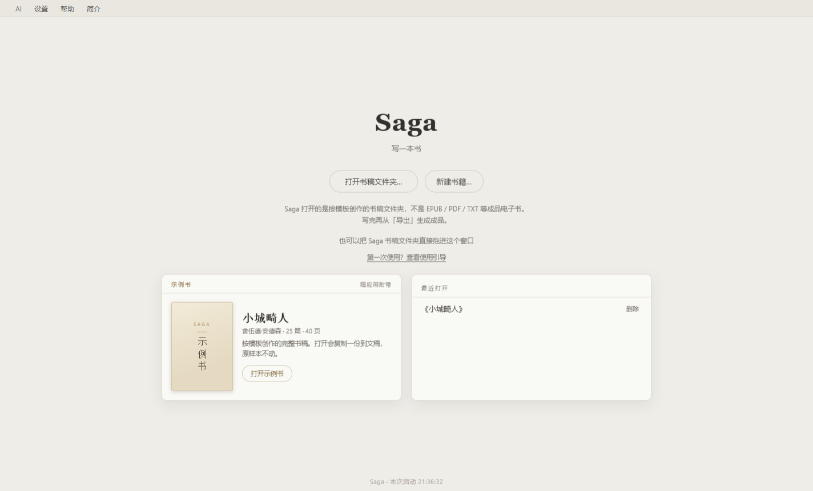
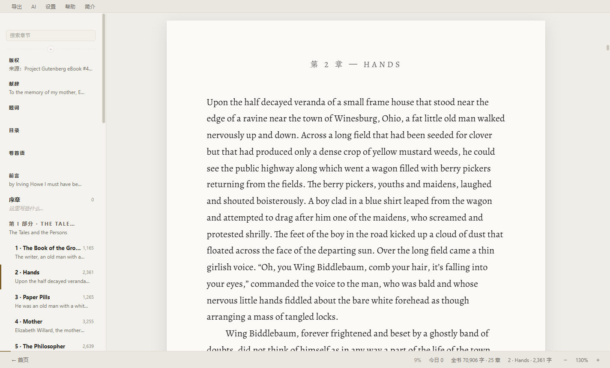
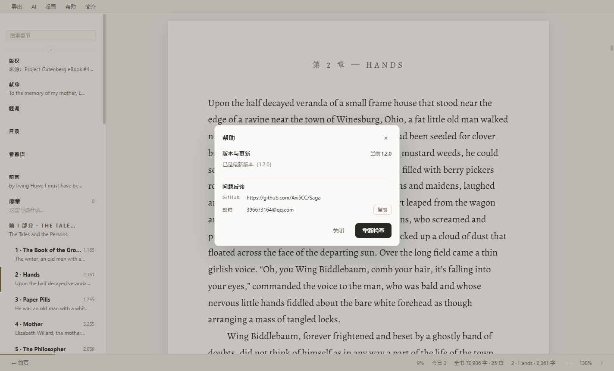

# Saga

Saga 是一个本地写作工具：按模板新建一本书稿，安静地写，写完导出成成品。

它不是电子书阅读器。Saga 打开和创建的是**书稿文件夹**，不是 EPUB、PDF、TXT 等成品电子书。



## 特点

- **书就是文件夹**：`book.json` 记录书名、作者和章节顺序，`chapters/` 里每一章是一个 HTML 文件。没有数据库，备份、同步和版本管理都很简单。
- **按模板开始**：新建时自动生成版权、献辞、题词、目录、卷首语、前言、序章、三部分正文、尾声、番外、后记、致谢、关于作者；没有内容的页可以留空。
- **专注写作**：左侧目录、中间纸张，改动自动保存；支持目录搜索、缩放、深浅两套主题。
- **八种正文字体**：宋体、黑体、楷体、仿宋、小薇、毛笔、得意黑、系统默认。PDF / KDP / EPUB 会内嵌字体，其他导出格式记录字体名。
- **章节管理**：章节之间用加号插入新页；右键可以上移、下移、删除。删除的文字会进入 `darlings/`，随时可以找回。
- **导出成品**：TXT、Markdown、HTML、EPUB、DOCX、ODT、RTF、LaTeX、PDF，以及 KDP 纸质书的内页 PDF + 封面模板。
- **示例书**：随应用附带《小城畸人》（舍伍德·安德森，公版作品），打开就能看到一份完整书稿的样子。
- **帮助与自动更新**：顶栏「帮助」显示当前版本、GitHub 仓库地址和反馈邮箱；启动后自动检查新版本，发现新版会弹窗提示，确认后下载、校验 SHA256 并安装。
- **AI 接入**：安装版自带命令行和 MCP 服务，可让 Claude Desktop、Cursor、Trae 等读写书稿。





## 书稿文件夹

```
小城畸人/
  book.json       书名、作者、章节顺序、章节类型
  chapters/       每章一个 .html 文件
  darlings/       删除或 AI 改写前的原文备份（可选）
```

Saga 只认识这样的文件夹。EPUB、PDF、TXT 是导出后的成品，不是导入格式。

## 下载

安装包（`Saga-Setup-*.exe`）和便携版（`Saga-Portable-*.exe`）放在本仓库的 **Releases** 页面，当前版本 **1.2.0**。

便携版可以直接运行，但 AI 接入（CLI / MCP）需要安装版，因为便携版每次从临时目录启动。

## 从源码运行

需要 Node.js 20 或更新版本。

```bash
npm install
npm start
```

## 使用

1. 点「新建书籍…」，选一个文件夹；或者打开已有的 Saga 书稿文件夹。
2. 左边点一章，直接在中间的纸上写。改动会自动保存，不需要按保存。
3. 写完点顶栏「导出」，选择格式。

常用快捷键：

- `Ctrl/⌘ + S`：立即把当前修改写回磁盘
- `Ctrl/⌘ + O`：打开书稿文件夹
- `Ctrl/⌘ + F`：搜索章节

## CLI 与 MCP

安装版在「AI」弹窗里会按当前电脑的安装位置生成配置，直接复制即可，不需要手改：

- **MCP**：`command` 是 `Saga.exe`，`args` 指向安装目录下的 `resources/ai/mcp-server.js`，并设置 `ELECTRON_RUN_AS_NODE=1`。
- **CLI**：使用 `resources/ai/saga.cmd`。

常用命令：

```bat
saga.cmd books
saga.cmd info "<书文件夹>"
saga.cmd read "<书文件夹>" 1
saga.cmd write "<书文件夹>" 1 --text draft.txt
saga.cmd export "<书文件夹>" --format epub --out "<输出.epub>"
```

运行 `saga.cmd help` 可以看到全部命令。书写入前会备份到 `darlings/`；如果这本书正在窗口里打开，写入会被拒绝——先点「← 首页」再让 AI 写。

## 项目结构

| 文件 | 作用 |
|---|---|
| `main.js` | 窗口、菜单、所有磁盘操作、导入、导出、无窗口打印 |
| `preload.js` | 渲染层唯一的 API：`window.saga` |
| `index.html` | 首页与编辑器两个视图 |
| `app.js` | 整个界面：写作、章节、目录、设置、导出、引导 |
| `styles.css` | 全部样式与主题变量 |
| `fonts/` | 七套开源中文字体（各自许可见子目录） |
| `example/` | 随应用附带的示例书稿 |
| `ai/` | 书稿读写核心、CLI、MCP 服务与导出构建器 |

## 字体许可

字体来自各自的开源项目：Noto Serif SC、Noto Sans SC、霞鹜文楷、朱雀仿宋、站酷小薇、马善政毛笔、得意黑。许可见 `fonts/<字体名>/LICENSE`，随应用一起分发。

## 许可

代码以 [MIT](LICENSE) 许可发布。
